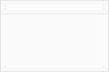

% Sonarr: Functional Specification (benchmark FSD)
This document describes the screens of Sonarr, a TV series manager, as agreed with the client. It covers the library, the calendar, activity, wanted episodes, settings and the system screens.
#! Library
The library holds every series the user has added. Each series has a root folder, a quality profile, a series type and a set of tags.
##! Adding a series
The Add New screen lets the user search for a series by name and add it to the library.
For each search result the user picks the options below before adding it.
| Option | Meaning |
|---|---|
| Root Folder | The library folder the series is stored in. |
| Monitor | Which episodes are monitored at first: all, future, missing, existing, recent, pilot, first season, last season, specials, or none. |
| Quality Profile | The quality profile used to download the series. |
| Series Type | Standard, daily or anime; this changes how searches are made. |
| Tags | Tags link the series to delay profiles, release profiles and indexers. |
- Start search for missing episodes: when ticked, the new series' missing monitored episodes are searched for straight after adding.
Up to 10 series can be selected from the search results and added together in one step.
A series that is already in the library is marked as such in the search results and can't be added a second time.

##! Series details
The series details screen shows one series: its poster, overview, network, status, path, size on disk and its seasons, with each season's episodes listed underneath.
The user can monitor or unmonitor the whole series, a season, or a single episode.
The user can search for all monitored episodes of the series, or for one season, or for one episode, either automatically or interactively.
The user can edit the series: its monitoring, quality profile, series type, path and tags.
The episode list of a series can be exported as a CSV file.
Deleting a series always deletes its folder and all its files from disk.
The user can refresh the series to fetch the latest information about it and rescan its files.
#! Calendar
The calendar shows episodes that aired recently and those coming up, by month, week, forecast or day.
Monitored and unmonitored episodes can be shown or hidden, and episodes already downloaded are marked.
Episodes can be dragged to another day to change their air date.
Sonarr can share the calendar as an iCal feed, which covers the previous 14 days and the next 60 days.
The iCal feed can be limited to series with given tags, and to premieres only.
# 3 Activity
Activity shows what Sonarr is downloading now and what it has done.
## 3.1 Queue
The queue lists the releases the download clients are downloading for Sonarr, with each release's series, episode, quality, progress and time left.
The queue is not stored by Sonarr: it is read from the download clients.
A release that can't be imported automatically shows a warning with the reason.
The user can remove a release from the queue. Removing an item from the queue always adds the release to the blocklist.
Each queue item has a priority (High, Normal or Low) that the user can change to reorder the downloads.
## 3.2 History
History lists everything that has happened to episodes: grabbed, imported, upgraded, deleted, renamed and failed.
The list can be filtered by event type, and more columns can be shown from the options.
For a grabbed release the user can open its details: the indexer it came from, its age and the release title.
Any history entry can be undone, which restores the episode file that an upgrade replaced.
# Wanted
## Missing episodes
The missing screen lists monitored episodes that have aired but have no file on disk.
Episodes whose file exists but whose quality is below the cutoff are not listed here.
The user can search for the selected episodes, or for all missing episodes. Search All starts straight away, without asking the user to confirm.
The user can toggle between monitored and unmonitored missing episodes.
A weekly email digest lists every missing episode.
# Settings
## Tags
Tags link series to delay profiles, release profiles, indexers, import lists, notifications and download clients.
The tags screen lists every tag with the number of things that use it.
Tag labels may contain letters, numbers, spaces and underscores.
Deleting a tag removes it from every series, profile and indexer that uses it.
Each tag has a colour, chosen from a palette of 12 colours, which is shown wherever the tag appears.
## Profiles
### Quality profiles
A quality profile lists the qualities the user wants, in order of preference, and the quality at which upgrades stop (the cutoff).
- Name: the profile's name, which is required.
- Upgrades Allowed: when ticked, a file is replaced by a better release until the cutoff is reached.
- Upgrade Until: the cutoff quality.
### Delay profiles
A delay profile makes Sonarr wait before grabbing a release, so that a better one can appear.
- Preferred Protocol: Usenet or Torrent.
- Usenet Delay and Torrent Delay: in minutes; neither can be negative.
- Tags: a delay profile applies to the series with the same tags.
The default delay profile can be given tags like any other.
## Quality definitions
The quality definitions screen lists every quality with its title and its minimum, preferred and maximum size in megabytes per minute.
Each quality can be limited to a maximum episode runtime.
## General
### Logging
The log level can be set to info, debug or trace.
Each log file can grow up to 50 megabytes before a new one is started.
### Backups
- Folder: where backups are written; a relative path is inside Sonarr's data folder.
- Interval: how often an automatic backup is taken, from 1 to 30 days.
- Retention: how long backups are kept, up to 365 days.
## Interface
The interface settings set the first day of the week and the column headers of the calendar.
The short date format, long date format and time format can be chosen, and dates can be shown relative to today.
Theme: Light, Dark or Auto.
The language of the interface can be chosen.
The font size can be set to small, medium or large.
# System
## Backups
The backups screen lists the backups Sonarr has made, newest first, with their type, size and date.
The user can take a backup now, restore from a backup in the list, or restore from a backup file they upload.
Backups can be copied automatically to an S3 bucket.
